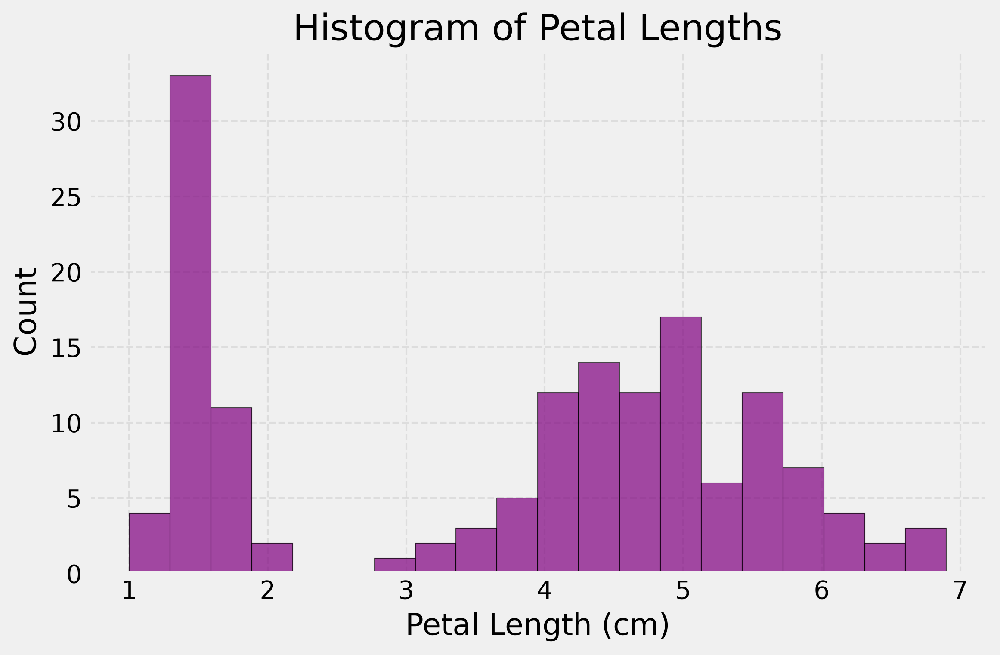

# Iris-Analysis Project-groupA
## Project Overview

This project uses Python to explore and analyze the Iris dataset. I practiced Python fundamentals, file handling, data cleaning, and data visualization using pandas and Matplotlib.
## Dataset Description

The Iris dataset contains 150 flower observations from three species: Iris-setosa, Iris-versicolor, and Iris-virginica.
The dataset has five columns:
- Sepal Length
- Sepal Width
- Petal Length
- Petal Width
- Species
  
Each species has 50 observations. The four measurements are in centimeters, and the species column identifies the flower type.

## Repository Files

- `Iris_project.ipynb` – Jupyter Notebook contain code, analysis, graphs, and reflections.
- `iris.data`: The raw dataset converted into standard CSV format.
- `iris_cleaned.csv` – Dataset with named columns, checked for missing values and data types.
- `iris_classes.csv` – Iris dataset with petal length categories.
- `summary.txt` – Summary statistics of the Iris dataset.
- `README.md` – Project documentation.

## Steps Performed

### Phase 1 – Setup
- Practiced a basic Python program using the print() function.

### Phase 2 – Python Fundamentals
- Loaded the Iris dataset using pandas.
- Practiced variables, conditional statements, loops, and functions.

### Phase 3 – File Handling & Data Cleaning
- Read the dataset using the CSV module.
- Calculated minimum, maximum, and average values.
- Checked missing values and data types.
- Saved summary.txt and iris_cleaned.csv.

### Phase 4 – Analysis & Visualization
- Counted flowers by species using a loop.
- Categorized flowers by petal length.
- Calculated descriptive statistics.
- Created a histogram, bar chart, boxplot, and scatter plot.
- Exported the categorized data to iris_classes.csv.

 ## Example Graphs

The following graphs were created using the Iris dataset:

- **Histogram:** Shows the distribution of petal lengths.
- **Bar Chart:** Compares average sepal length across the three species.
- **Boxplot:** Shows the spread and median of petal lengths for each species.
- **Scatter Plot:** Shows the relationship between sepal length and sepal width.
  ### Histogram of Petal Lengths

